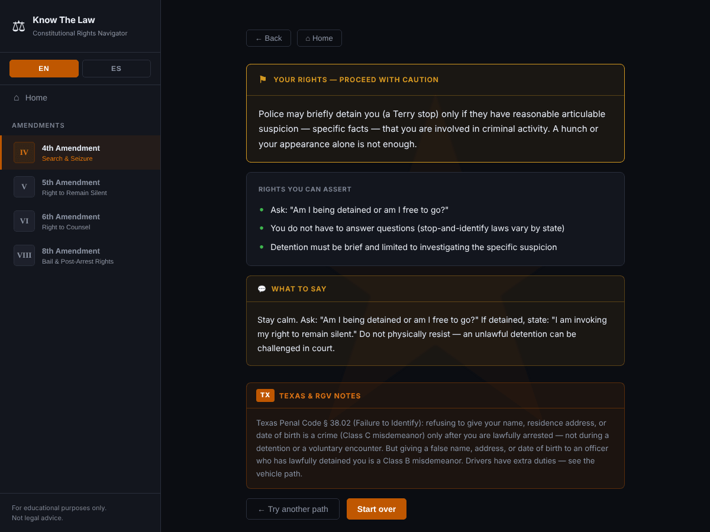

# ⚖ Know The Law
### Constitutional Rights Navigator for the Rio Grande Valley

> *"Know your rights, be protected."*

**Winner, Best Beginner at Frontera Hacks 2026** (UTRGV's hackathon)

**Live site:** [krizzzp1.github.io/Know-The-Law](https://krizzzp1.github.io/Know-The-Law/)



---

## The Problem

The RGV navigates a layered law enforcement reality that most Americans never encounter: city and county police, the Texas Department of Public Safety, U.S. Border Patrol, ICE, CBP officers at checkpoints; all operating simultaneously.

This is not hypothetical. It is daily life for the 1.4 million people who call the RGV home.

In this environment, a routine traffic stop can involve federal agents. A walk through a parking lot can trigger a stop and question demand. Detainments at interior checkpoints, some as far as 70 miles from the border, can escalate quickly when people don't know what they are and are not legally required to do.

**Most residents don't know their rights. And when they need that knowledge, there is no time to Google it.**

---

## What Know The Law Does

**Know The Law** is an interactive, decision-tree-based constitutional rights navigator built for everyday people.

It walks users through real scenarios step by step:

- *"Police want to search my vehicle"* — do I have to let them?
- *"I was just arrested"* — what do I say, and when do I stop talking?
- *"My bail seems too high"* — what are my options?
- *"I'm in holding"* — what rights do I still have?

Each path through the tree delivers an explanation of the relevant constitutional protection, a bulleted list of rights you can assert right now, and a high-visibility "What to say" block with the exact words to use in a high-stress encounter.

---

### The Offline Implication

Rural stretches of Hidalgo, Cameron, Starr, and Willacy counties have inconsistent cellular coverage. Know The Law is built with zero runtime dependencies, no API calls, no CDN, no internet required. The entire application runs from a single folder of static files. A resident can save it to their phone, their car, or a USB drive and access it anywhere.

---

### Bilingual

The RGV is one of the most Spanish-dominant regions in the country. About 4 in 5 residents speak Spanish at home (U.S. Census Bureau, American Community Survey), and many are more comfortable navigating legal concepts in Spanish than in English. Know The Law is fully bilingual. An EN/ES toggle switches the whole app between English and Spanish at any point, without losing your place in the decision tree.

---

## Constitutional Coverage

| Amendment | What It Covers |
|---|---|
| **4th** | Home searches, vehicle stops, street detentions, Terry frisks, phone/device searches |
| **5th** | Miranda rights, custodial interrogation, right to remain silent, compelled evidence, grand jury |
| **6th** | Right to counsel, public defenders, arraignment, speedy trial, right to know charges |
| **8th** | Bail process, excessive bail, bail denial, pre-trial detention rights, rights while in holding |

---

## Accessibility

The whole decision tree works with only a keyboard: Tab moves between controls, the arrow keys pick an answer, and Enter continues. Switching to Spanish also switches the page's language setting, so screen readers read Spanish as Spanish. Every screen passes automated [axe-core](https://github.com/dequelabs/axe-core) checks in both languages.

---

## Run It Locally

There is nothing to install and no build step.

```
git clone https://github.com/KrizzzP1/Know-The-Law.git
cd Know-The-Law
start website\index.html
```

`start` is the Windows command. On macOS use `open website/index.html`, and on Linux use `xdg-open website/index.html`.

| Path | What it is |
|---|---|
| `website/index.html` | The page shell, link-preview tags and icons |
| `website/app.js` | The decision trees and all legal text in English and Spanish, plus the code that draws each screen |
| `website/style.css` | Layout and colors |
| `.github/workflows/deploy.yml` | Publishes `website/` to GitHub Pages on every push to `main` |

---

## Found Something Wrong?

Laws change. If something here is wrong or out of date, please [report an inaccuracy](https://github.com/KrizzzP1/Know-The-Law/issues/new?template=inaccuracy.yml) with a link to a source. The legal content was last reviewed against official sources in November 2026.

---

## How It Was Built

Know The Law was a solo project. I designed the decision tree: the scenarios it covers, the questions it asks, and every outcome a user can reach. I researched and wrote all of the legal content. The code was written with AI development tools that I directed, through testing and deployment.

---

## Built For

This project was built with the Rio Grande Valley community and Texas residents in mind, a region whose residents deserve the same access to legal knowledge that money and education have always provided to others.

---

## License

[MIT](LICENSE)

---

*My project "Know The Law" is for educational purposes only and does not constitute legal advice*
